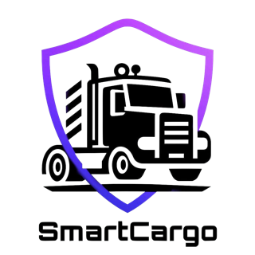
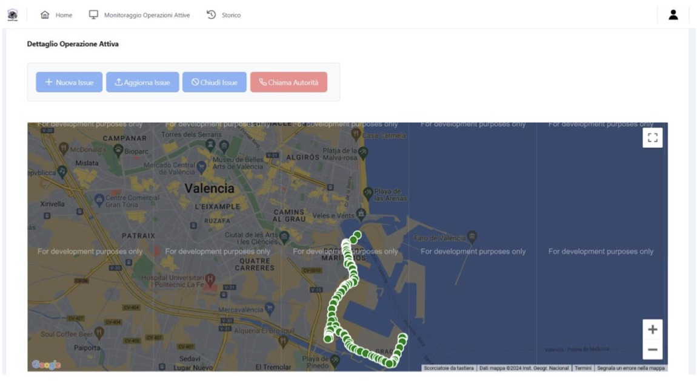

<p align="center">
  
</p>

<h1 align="center">SmartCargo</h1>

<p align="center">
  <b>A web platform for the Port of Valencia that plans optimal truck routes, tracks trucks in real time and flags route deviations.</b><br>
  Delivered on schedule and within 1% of budget by a team of two project managers and six developers.
</p>

<p align="center">
  <a href="#my-role-project-manager"><b>🧭 My role</b></a> ·
  <a href="#project-health-earned-value"><b>📈 Project health</b></a> ·
  <a href="#the-product"><b>🚚 The product</b></a> ·
  <a href="Deliverables"><b>📂 All deliverables</b></a>
</p>

---

## At a glance

| | |
|---|---|
| **Context** | University of Salerno, two coordinated courses: MSc *Software Project Management* (the project managers) and BSc *Software Engineering* (the development team) |
| **My role** | **Co-Project Manager**, with Nicola Tortora: planning, monitoring and control, risk management and team coordination |
| **Team** | 2 project managers and 6 developers, with 50 hours budgeted per developer |
| **Timeline** | October 2023 to January 2024. The first release was due on 16 January 2024 and shipped on time |
| **Outcome** | Delivered on the milestone with **SPI 1.00** and **CPI 0.99**: a €66 overrun on a €9,462 labour baseline |
| **Product stack** | Angular 15 · PrimeNG · Google Maps · Python Flask · SQLAlchemy · MySQL · scikit-learn |

## My role: Project Manager

I co-led the project from initiation to closure. Nicola Tortora and I wrote the management documentation together, about half each according to the revision histories. I was the lead author of the initiation documents (project charter, business case, Statement of Work) and of the closing lessons-learned report. Everything is in [`Deliverables/Management`](Deliverables/Management).

| Phase | What I did | Artefacts |
|---|---|---|
| **Initiation** | Defined the business case, scope and success criteria, and kept the team aligned on them | Business case and financial analysis, Statement of Work, Project Charter |
| **Planning** | Broke the work down, estimated it and built the schedule and cost baseline | WBS and WBS dictionary, schedule, cost baseline |
| | Planned for risk, quality, configuration and stakeholders | Risk management plan and risk register; quality, configuration and stakeholder management plans; RACI matrix |
| | Planned the agile phase | Scrum process plan |
| **Execution** | Trained the team on the technology stack, then split the work into front-end and back-end streams | Training material, Trello board |
| | Ran weekly progress meetings | 10 agendas and 9 sets of minutes |
| **Monitoring and control** | Tracked progress with Earned Value Management at 5 checkpoints | EVM workbook, 3 status reports |
| | Run the implementation as Scrum sprints | 3 sprint reports |
| | Managed risks as they became real (see below) | Updated risk register |
| **Closure** | Gathered feedback from the whole team and wrote up what to repeat and what to avoid | Lessons-learned report, post-mortem reviews (PM and team) |

**Process.** The documentation phases (requirements, system design and object design) followed a waterfall model with retroactive verification and validation. Implementation switched to **Scrum** over three sprints, each closed by a review and a retrospective.

## Project health: Earned Value

| Checkpoint | Phase | EV (€) | AC (€) | CPI | SPI | Status |
|---|---|---:|---:|---:|---:|:---:|
| 27 Nov 2023 | Requirements elicitation | 3,725 | 3,335 | 1.12 | 1.00 | 🟢 |
| 13 Dec 2023 | RAD / SDD | 4,813 | 4,876 | 0.99 | 1.00 | 🟡 |
| 19 Dec 2023 | RAD / SDD / ODD | 5,188 | 5,251 | 0.99 | 1.00 | 🟡 |
| 2 Jan 2024 | ODD and development | 6,705 | 6,976 | **0.96** | **0.97** | 🟡 |
| 16 Jan 2024 | Development and testing | 9,463 | 9,529 | **0.99** | **1.00** | 🟢 |

**How we recovered the slip.** Over the Christmas break the team lost focus, and the *Development* work package fell to 83% of plan (CPI 0.96, SPI 0.97). We had flagged a late-delivery risk in the status report, and we responded to it in two ways:
1. We added working hours to recover the lost time, accepting a small cost increase to protect the delivery date.
2. We ran the front-end and back-end work in parallel to shorten the critical path and limit that cost increase.

Two weeks later the project was back on schedule (SPI 1.00), and it closed with a cost variance of only −€66.

## The product

SmartCargo supports the people who handle cargo at a commercial port. Its goals are to improve safety, speed up loading and unloading, and cut truck CO₂ emissions by sending trucks along shorter routes.

<p align="center">
  <br>
  <sub>Live monitoring: the control-room operator follows a truck on the map and can open an issue or call the authorities.</sub>
</p>

| User | What they can do |
|---|---|
| **Gate operator** | Register a truck's entry, check it, and record its operation, with a QR code for each operation |
| **Truck driver** | Register an account, see the **optimal route** for each active operation, check out of the port |
| **Control-room operator** | **Monitor trucks in real time** on the map, get an **alert on route deviations**, open, update and close issues, call the authorities, browse the history |
| **Warehouse operator** | Check cargo information and report the outcome of loading and unloading |

**Under the hood**
- **Optimal route:** A* search over the port's road graph.
- **Deviation detection:** reference routes are reduced with **DBSCAN** clustering on GPS data (haversine metric). A truck is flagged when it drifts beyond a distance threshold from its route.
- **Architecture:** an Angular single-page app talks to a Flask REST API. The API is layered as controllers → facade → services → data access, on MySQL through SQLAlchemy.

**Quality**
- **Unit tests:** `unittest` for the back-end services, with a branch coverage report ([`Deliverables/Product/4. Branch Coverage`](Deliverables/Product)).
- **System tests:** Selenium IDE tests for login, driver registration, entry registration and issue opening.
- **Test documentation:** a test plan, test case specification, test incident report and test summary report.

## Lessons learned

These come from the closing report written by the project managers.

- ✅ **Training before development paid off.** Giving the team material on the stack beforehand cut development time.
- ✅ **Scrum worked for implementation.** After an initial adjustment the team organised itself well.
- ✅ **A clear scope from day one.** Preliminary sessions checked that everyone understood the domain.
- ⚠️ **Early estimates were the weakest point.** Some tasks were over- or under-estimated, which delayed some deliveries. Next time: more structured estimation.
- ⚠️ **Check tool limits before adopting a tool.** Slack's free plan became a constraint, so communication moved to Discord.

## Deliverables

| Area | Contents |
|---|---|
| [Management](Deliverables/Management) | Initiation documents, scope, WBS, schedule and cost, risk, configuration, Scrum, quality and stakeholder plans; status, sprint, EVM and final reports; meeting agendas and minutes |
| [Product](Deliverables/Product) | Requirements (RAD), system design (SDD), object design (ODD), test documentation and system test files, user and installation manuals, branch coverage |

Presentations:
- [Project managers' presentation](https://www.canva.com/design/DAF6uTVis9s/BMEmk4i4gFNNHjiz9rObMg/view?utm_content=DAF6uTVis9s&utm_campaign=designshare&utm_medium=link&utm_source=editor)
- [Development team's presentation](https://www.canva.com/design/DAF6oBN4d58/_bE7eIt4P1xdDIiTGEIbTA/view?utm_content=DAF6oBN4d58&utm_campaign=designshare&utm_medium=link&utm_source=editor)

## Run it locally

**Back end** (Python 3.11 and MySQL):

```bash
cd backend
python3 -m venv venv && source venv/bin/activate
pip install -r requirements.txt
export DB_USER=root DB_PASSWORD=<password> DB_NAME=smartcargodb   # see .env.example
python mainSmartCargo.py
```

**Front end** (Angular): set `googleMapsApiKey` in `frontend/src/environments/environment.ts`, then run:

```bash
cd frontend
npm install
npm start
```

## Team

| Role | People |
|---|---|
| Project managers | **Vincenzo Esposito** · [Nicola Tortora](https://github.com/NickTor99) |
| Development team | [Mariapia Sorrentino](https://github.com/Marypi02) · [Andreea C. C. Oprisescu](https://github.com/andreea3111) · [Roksana Duda](https://github.com/Roksid2002) · [Amedeo Napolitano](https://github.com/amedeonapoli25) · [Francesco F. Ambrosio](https://github.com/francesco7000) · [Paolo Murino](https://github.com/PaoloMurino) |

<a href="https://github.com/vincenzo-esposit0/C07_SmartCargo/graphs/contributors">
  
</a>

---

<sub>Vincenzo Esposito · <a href="https://vincenzo-esposit0.github.io/">Website</a> · <a href="https://www.linkedin.com/in/vincenzo-e">LinkedIn</a></sub>
